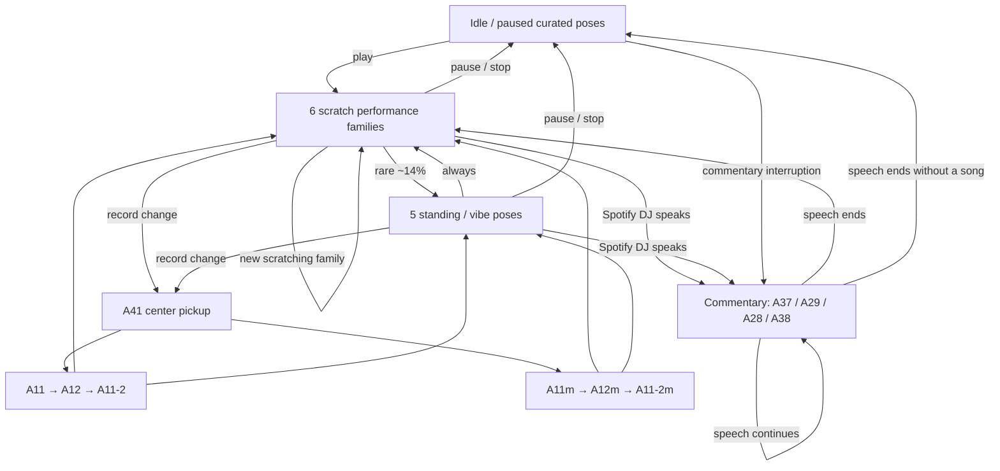

# PocketDJ · Curated Pose Transition Architecture

**Design study, November 17, 2026.** Based on the actual `src/dj/djController.ts` runtime, `src/dj/headBobController.ts`, the six scratch rigs, five active standing rigs, the fixed album-change sequence, idle/paused pools, and commentary poses. No production transition changes are included in this deliverable.

## 1 · Decision

**Recommended:** Reusable, hand-authored **pixel-art bridge clips**, rendered over the existing permanent DJ table/vinyl planes, with independently animated heads and arms where their existing rigs support the necessary motion. Prioritize common entries/exits to a small number of *hub poses*. Use an instant, anatomically correct cut as the fallback for a transition without approved bridge artwork.

Do **not** deploy generic mesh warps of the DJ, free-form body stretching, alpha crossfades of whole sprites, or per-pixel morphs between different silhouettes. Those techniques produce ghost faces, duplicate hands, missing sleeves and malformed shoulders. They can look acceptable in isolated stills but fail at playback speed.

### The visual invariants

1. **582 × 652 source pixels, integer-pixel registration.** Never scale/squeeze the body to create a new pose. Use nearest-neighbor sprite rendering.
2. **One static table.** The approved A8 reference table stays fixed; the vinyl disc planes rotate continuously. Do not place copied table or record pixels inside an interpolating DJ overlay.
3. **Anatomy survives every frame.** One head, two arms, continuous hood/neck seam, stable shoulder joints, no extra fingers or half-transparent limbs.
4. **Album-change overlays keep their current priority.** The held-record quad warp and fingerprint/finger masks must follow the legal cinematic sequence; the album should already be on the deck when the next song begins, when queued art allows the pre-roll.
5. **Transitions can be interrupted.** Spotify skip, speaking pose takeover, idle/paused, or a new record-change must cancel an uncommitted bridge cleanly and leave one complete, valid pose.
6. **No unapproved synthesis in production.** A missing bridge selects a known-safe hard cut rather than an attractive but malformed approximation.

## 2 · What PocketDJ can actually transition between

The [machine-readable directed graph](./pose-transition-graph.v1.json) is a snapshot of the live animation scheduler. The interactive Pose Transition Studio visualizes it as a source/destination matrix.

There are **23 distinct curated base image nodes** and **440 directed, state-specific transition cases** representing **279 distinct ordered source/destination image pairs**. The 440 figure includes multiple distinct state changes that happen to have identical source/destination images. Same-image transitions are not counted because there is no visual jump. It excludes **I6** (explicitly requested) and **A36** (reference-only). It also excludes keyboard audition/manual debug jumps, which are not automatic playback edges.

| Automatic path | Directed cases | Legitimate movement |
|---|---:|---|
| Scratch family → different scratch family | 30 | Six scratch families, excluding a repeat of the same family |
| Scratch → standing/vibe | 30 | Five standing poses, infrequent selection |
| Standing/vibe → scratch | 30 | **Mandatory** after standing; never standing → standing |
| Idle / paused curated pool | 30 | I7, I9, I1, I10, I11, I12 (without I6) |
| Idle/paused → playing | 63 | Only changed-image edges counted |
| Playing → idle/paused | 63 | Only changed-image edges counted |
| Playing → cinematic pickup A41 | 22 | Eleven possible preceding playing poses × 2 record-change sides |
| Cinematic consecutive frames | 6 | Three consecutive links in each of the two fixed branches |
| Last cinematic frame → playing | 22 | Two endpoints × eleven possible performance poses |
| Playing → commentary pose | 42 | A37, A29, A28, A38; same-image edges excluded |
| Commentary → different commentary | 12 | The 4.5-second commentary pose change |
| Commentary → playing | 42 | Return after speaking |
| Idle/paused → commentary | 24 | Commentary can interrupt other display states |
| Commentary → idle/paused | 24 | Speech may end without a playing song |
| **Total** | **440** | **279 unique ordered image pairs** |

### Actual state paths



**Critical sequence fact:** A11, A12, A11-2 (and their mirrored partners) cannot be selected directly from an arbitrary active/idle pose during automatic playback. **A41 is the single cinematic entrance.** This makes the bridge *into A41* reusable and far more valuable than independently authoring entries to every middle frame. A41 itself is side-aware even though its base image is the same; the held album uses different calibrated left/right placements.

### Which artwork transitions are already smooth?

Inside a single scratching family (for example, `A44 → A44-2 → A44-3`) the deployed independent scratch rigs interpolate left and right arms and the head nod rig independently. Those are **not** a new pose-family transition problem. The new effort is the **inter-family handoff** (`A44 → A47`, `A10 → I12`, etc.) and the **mode/cinematic/commentary boundaries**.

## 3 · Technique comparison

| Technique | Anatomy | Pixel fidelity | Authoring cost | Recommendation |
|---|---|---|---|---|
| Instant hard cut | Valid complete sprite | Excellent | None | **Safe fallback** if unapproved |
| Whole-sprite alpha fade | Doubles faces/hands | Poor | None | Reject |
| Whole-body mesh/affine warp | Distorts face, hood and arms | Poor | Medium | Reject |
| Per-pixel Bayer replacement | Mixed silhouettes, flicker-like texture | Crisp pixels, compromised body | Low | Experiment only |
| Horizontal/region reveal | Can split torso/neck | Crisp pixels, compromised anatomy | Low | Experiment only |
| Blindly pass through an existing pose | Two jarring snaps instead of one | Good sprites | Low | Useful route diagnostic, not final |
| Animate already-isolated arm/neck pieces | Preserves pixels if seam repair exists | Excellent | Medium | Use on similar posture families |
| Hand-authored joint/shoulder/key-pose bridge | Continuous anatomy | Excellent | Higher upfront, reusable | **Preferred** |

### Why hubs beat pair-by-pair sprite authoring

Directly drawing three intermediate frames for 279 ordered pairs would require approximately **837 bespoke drawings** before revisions. Even focusing on the 90 playback performance cases would require hundreds of frames and ongoing maintenance. A few **reviewed shared bridges** turn this into a set of reusable entrances/exits.

Proposed **hub poses** (existing sprites are *references*, not automatic seamless interpolation):

| Hub | Reference | Function |
|---|---|---|
| `H-DECK` | A44 | Both hands positioned near the turntables; scratching ↔ scratching |
| `H-READY` | I12 | Arms withdrawn to waist/hips; scratching ↔ standing/rest |
| `H-CROSS` | I10/I7 | Stable arms-crossed rest; crosses and crossed-to-uncrossed motions |
| `H-REST` | I9 | Arms relaxed/hoodie pockets; idle ↔ playing |
| `H-PICKUP` | A41 | Hands toward central vinyl; all performance → fixed record-change sequence |
| `H-SPEECH` | A37 (reference) | Return/reach gesture for commentary interludes |

The new bridge **art** still has to show a plausible move into/out of each hub. An existing reference pose is not itself a valid in-between frame. These are route-reuse primitives, not shortcuts to automatic geometry generation.

## 4 · Recommended per-family transition treatment

| From → To | Natural visual action | Expected bridge effort |
|---|---|---|
| A44 ↔ A47 ↔ A48 | Hands stay on both decks; move shoulders/head lean and wrists | Low–medium: shared arm layer poses + 1–2 shoulder repair frames |
| A10/A4 ↔ A14 | Left hand drifts from record, right hand moves between deck/mixer | Medium: reposition arm paths and head turn; 2–3 drawn sleeve states |
| Any scratch ↔ I12 | Withdraw hands from decks to hips, or reverse | High: 3–5 authored arm/hood stages |
| Any scratch ↔ I10 or I7 | Hands come off decks and cross chest | High: make forearm crossing and overlap explicit; 4–6 stages |
| Any scratch ↔ I11 | Hands come together at chest | High: separate both forearms, preserve fingers and neckline |
| Any scratch ↔ A37/A38 | Raise a thumb or waving arm | High: shoulder socket repair, raised-hand perspective; 3–5 stages |
| I10 ↔ I7 | Similar crossed arms, different shoulder, head and overall height | Medium: small shift and head orientation frames; no torso stretch |
| I9 ↔ I12 | Move hands out of hoodie/pockets to hips | Medium: 2–4 drawn hand/hoodie frames |
| I1 ↔ any upright pose | Sit/lean back to upright; legs visibly move | **Very high:** full-figure 4–6+ illustrated keyframes; do not warp legs |
| Any performance → A41 | Both hands collect central record; eyes/face reorient | High-priority shared pickup bridge; 3–5 keyframes, then existing A41 |
| A41 → A11 → A12 → A11-2 | Raise and place record on right | Fixed ordered clip; preserve calibrated held-record quad and finger occlusion |
| A41 → A11m → A12m → A11-2m | Mirror record move on left | Separate reviewed clip; **do not** naively mirror album artwork or hands |
| A11-2 / A11-2m → performance | Release placed record, hands return to ready/performance | Shared return-hands bridge per side, then target family |
| Performing ↔ commentary | Change hand gesture while keeping eyes/head natural | Interruptible upper-body bridge and frame abort path |

## 5 · Proposed runtime integration design (later phase)

Build a `PoseTransitionDirector` separately from the existing `DjController` state machine. It consumes *approved* actual directed transitions, then chooses a resolved route. It does not replace the existing scheduler:

```text
DjController (source/target, song changes, interrupt priority)
  → PoseTransitionDirector.resolve(from, to, mode)
  → [approved shared hub path | approved pair clip | safe hard cut]
  → FrameRenderer (one pixel-locked torso/head/arm set)
       ├─ fixed table + spinning vinyl (existing layers, never reset)
       ├─ DJ torso / shoulder underpaint
       ├─ independent approved head and arm layers when available
       └─ held-record overlay and fingertip occlusion (cinematics)
```

**Transition manifest example** exported by the lab:

```json
{
  "schema": "pocketdj.pose-transition-experiment.v1",
  "from": "a44",
  "to": "i12",
  "durationMs": 460,
  "method": "authored",
  "bridgeFrames": [
    { "name": "bridge-1.png", "index": 0, "canvas": [582, 652] },
    { "name": "bridge-2.png", "index": 1, "canvas": [582, 652] }
  ]
}
```

Proposed production timing: **roughly 280–620 ms for a hand-authored cross-family bridge**, varying by change magnitude. Keep the existing 16–34-second scratch-family holds, 27–33-second standing holds, and beat-timed head nods unchanged. Transitions should **not** require full-person animation at 60 FPS: a few carefully drawn pixel-locked poses, displayed for 60–100 ms each, can look significantly more intentional than morphs.

**Interrupt rules:** Higher priority song-change cinematic > speaking/music state > queued pose-family changes. On interruption, freeze at a *complete approved* pose or finish a short hand-return, not an unsafe halfway blend. Album art and record angle never reset during this handoff.

## 6 · Authoring & verification roadmap

### Pilot, **do first**

1. Choose **A44 → A47** (similar both-decks postures), **A10 → A14** (offset hand placement), **A44 → I12** (scratch → standing), **I10 → A44** (return from crossed arms), and **A10 → A41** (cinematic pickup).
2. In the Pose Transition Studio, preview the baseline and unsafe algorithms at **1×**, **0.5×**, and **0.25×**. Note the most visible anatomical jumps.
3. Paint or import **2–5 valid intermediate keyframes** for each pilot transition; optionally adapt the approved arm/head rigs for isolated motion.
4. Export each pair ZIP and review frame-by-frame with the difference heatmap and onion-skin reference.
5. Only after these five clips pass visual QA, integrate the transition director into PocketDJ behind a flag. Retain hard-cut fallback for all other edges.

### Reuse, after pilot approval

6. Add shared `H-DECK`/`H-READY` exits and entries for the six scratching and five standing poses.
7. Add `H-PICKUP` and the two existing fixed cinematic branches, protecting the early song-change pre-roll and record placement order.
8. Extend to I7/I9/I10/I11/I12 and selected speech gestures. Handle I1 separately because of leg and torso motion.

### Ship gates

- No doubled eyes/faces/hands at any time or speed.
- No transparent holes/pink underpaint seams at shoulders, elbows, neck, hands, or across the table.
- No table deformation and no flashing or discontinuity in album-art rotation.
- No abrupt changes to the album/finger quad alignment during A41/A11/A12/placement.
- Sample playback at **0.25×, 1×, 2×**, pause/resume, skip, Spotify commentary interruption, and both left/right cinematics.
- Manual QA of both directions where applicable; **do not assume reversing the frames always makes physical sense**.
- Fallback should render a complete, good-looking pose if a bridge file fails to load.

## 7 · What the delivered utility can do now

- Inspect the **23-pose, 440-case directed map**; click allowed transitions in the matrix.
- Filter by actual production state transitions, including the two cinematic branches and commentary interruptions.
- Play any allowed pair at real speed or in slow motion; scrub, loop and change duration.
- Compare baseline cut, alpha ghosting, dither, pixel wipe, split-region and existing-pose waypoint as **diagnostics**, with unsafe methods explicitly flagged.
- Compare full sprite endpoints and measure changes to the character silhouette/head/torso viewport.
- Enable a change heatmap to see where the torso/head/hands differ.
- Create, upload, hand-paint, and undo edits to 582×652 full-sprite intermediate PNGs; use onion skins and a pixel color picker.
- Save per-edge disposition, method and notes; export an individual ZIP with PNGs and a metadata JSON, plus a machine-readable full graph / CSV and audit JSON.

**What it cannot claim:** The utility does not automatically produce anatomically correct intermediate animation. Existing poses in the waypoint preview are references only. Human-authored or properly isolated/rigged motion is required before any transition is approved for live playback.